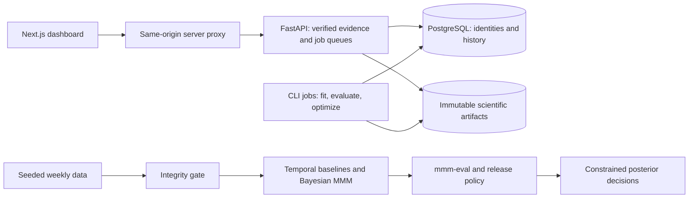

# mmm-decision-engine

Marketing mix model decision support: evaluate whether model evidence justifies
a budget recommendation, then propagate uncertainty into constrained decisions.

The seven-page dashboard shows data quality, model fit, channel uncertainty,
release reasoning, guarded scenarios and run history. The real reviewed demo is

## Run the dashboard

With Docker running and Node 22+ installed:

```sh
make dev
```

Open **http://127.0.0.1:3000** and select **Create sample workspace**. This generates
reproducible synthetic observations, without inventing trained-model results.
PostgreSQL and artifacts persist in Docker volumes; `make stop` stops the services.
The first build downloads the locked Python and JavaScript dependencies.

For an existing local PostgreSQL server, run these from the repository root:

```sh
uv sync --locked
createdb decisionguard_demo
export DATABASE_URL='postgresql+psycopg:///decisionguard_demo'
uv run alembic upgrade head
uv run decisionguard seed-demo
uv run uvicorn decisionguard.api.app:create_app --factory --host 127.0.0.1 --port 8000
```

In a second terminal: `cd web && npm ci && npm run dev`. Environment examples are
in [.env.example](.env.example) and [web/.env.example](web/.env.example); native
Python commands read exported environment variables, not `.env` automatically.

To show the existing **real precomputed runs**, use this **instead of** the
data-only `seed-demo` command above (the artifact directories must exist):

```sh
uv run decisionguard seed-demo \
  --dataset artifacts/phase2-demo \
  --model artifacts/mmm-reviewed-2000 \
  --sensitivity artifacts/mmm-sensitivity-reviewed \
  --evaluation artifacts/evaluation-production-resumable
```

This registers intact artifacts in place and preserves their hashes, configuration,
uncertainty and release state. Re-importing the same directories is rejected.

## How it works



Queued jobs execute separately using the experiment/model/scenario IDs shown in
Runs. With the same `DATABASE_URL` and `ARTIFACT_ROOT` as the API:

```sh
uv run decisionguard train --experiment-id EXPERIMENT_UUID
UV_PROJECT_ENVIRONMENT=.venv-evaluation uv run --no-default-groups --group evaluation decisionguard evaluate --model-run-id MODEL_UUID
uv run decisionguard optimize --scenario-id SCENARIO_UUID
```

Evaluation must first be queued with a compatible prior-sensitivity run via
`POST /model-runs/{id}/evaluate`. A blocked model cannot create or execute a
scenario. No command changes advertising accounts or live spending.

## Deployment preparation

[Dockerfile](Dockerfile), [Compose](compose.yaml), and [Cloud Run templates](deploy/)
are prepared locally. The [deployment runbook and threat model](docs/technical_spec.md#phase-10-local-deployment-preparation)
cover Vercel, Cloud Run, PostgreSQL, artifact storage, secrets and job execution.
Account connections, image builds on Docker, cloud verification and a public URL
remain pending. Local authentication is optional; production fails closed when
required credentials are missing. Public demo defaults are read-only.

The model assumes weekly AUD spend, constant weekly allocations, and conditional
predictions using realized controls. Modeled contribution is not experimentally
identified incremental profit.

## Local setup

Install [uv](https://docs.astral.sh/uv/), then run:

```sh
uv sync --locked
uv run ruff format --check .
uv run ruff check .
uv run pyright
uv run pytest
```

Python 3.12. See the [scope](docs/scope.md), [technical spec](docs/technical_spec.md)
and [roadmap](docs/roadmap.md) for details. Run `uv run decisionguard --help` for commands.

Frontend verification: `cd web && npm ci && npm run build && npm test` (install
Chromium first with `npx playwright install chromium`, or use
`PLAYWRIGHT_CHANNEL=chrome` with an installed Chrome). `DEMO_E2E=1` additionally
checks all seven pages against the running native API with imported real artifacts.
Browser contract tests use explicitly isolated HTTP fixtures. Database tests
require `DECISIONGUARD_TEST_DATABASE_URL` pointing to a database ending in `_test`.

## Agent exploration

Run the scripted safety tests and PostgreSQL integration tests:

```sh
uv run pytest tests/test_agent.py
# Use an existing dedicated PostgreSQL database whose name ends in _test.
DECISIONGUARD_TEST_DATABASE_URL='postgresql+psycopg:///decisionguard_test' \
  uv run pytest tests/test_agent_api.py
```
